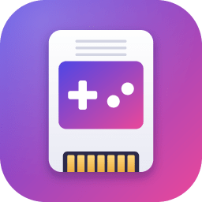
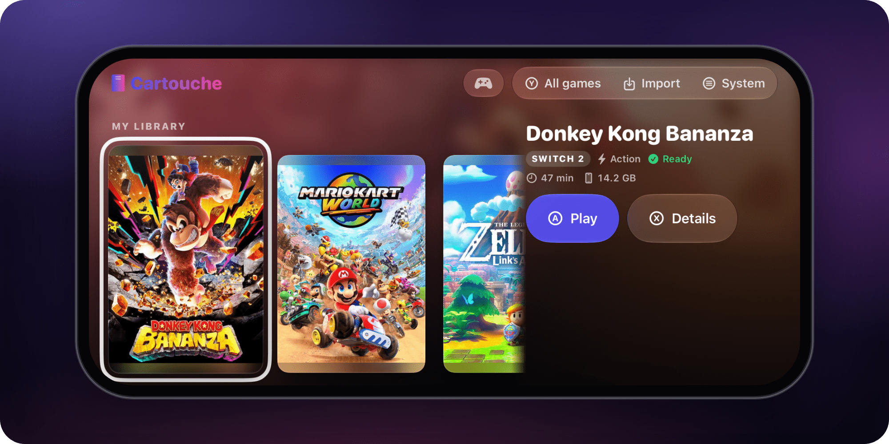
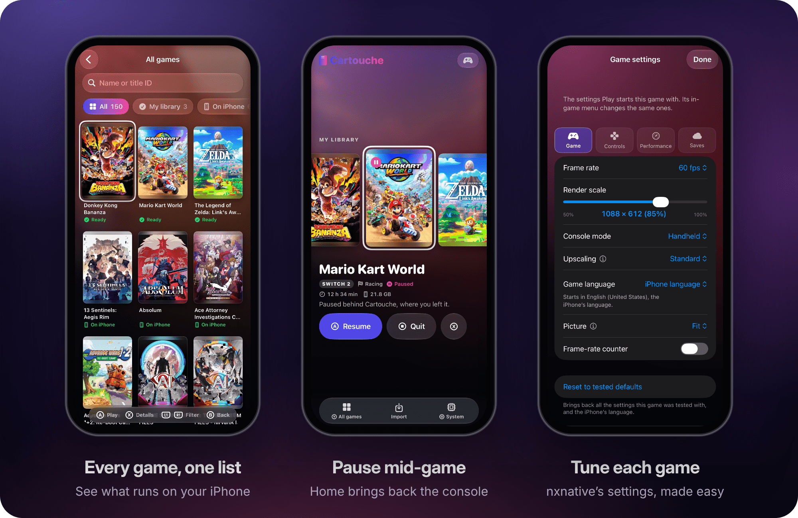
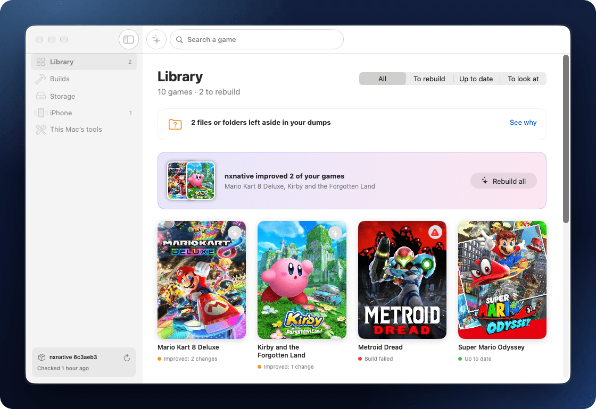

<div align="center">



# Cartouche

### Your iPhone becomes a console.

Cartouche installs, starts and keeps the games [nxnative](https://github.com/seedds/nxnative) runs natively on iPhone, from your own copies.<br>
It signs, renews and updates itself, and gets your games the memory they need.<br>
On your Mac, Cartouche Builder builds your games, and builds them again when nxnative improves them.

<a href="https://clabeuhtegrite.github.io/Cartouche/download/#installer-mac"></a>&nbsp;&nbsp;<a href="https://clabeuhtegrite.github.io/Cartouche/download/#installer-windows"></a>

**[Website](https://clabeuhtegrite.github.io/Cartouche/)** · **[Getting started](docs/getting-started.md)** · **[Premiers pas](docs/getting-started.fr.md)** · **[Roadmap](docs/roadmap.md)** · **[Report a problem](https://github.com/clabeuhtegrite/Cartouche/issues/new/choose)**



</div>

> [!IMPORTANT]
> **No games included, ever.** Cartouche ships no games, no keys and no firmware, and never downloads them. You bring your own copies, dumped from your own console and built with nxnative. Please don't ask for IPAs.

## What it does

- **A console's home.** Your games on one shelf, with their official covers. Every game of nxnative's list is one step away, each with a sheet: its description, which the iPhone translates into your language, how it runs on your iPhone, your play time and the room it takes. Touch or a game controller, on every screen.
- **Your games, installed and played in Cartouche.** Install a game from your storage or import an IPA you built, play it, change its nxnative settings on a page of Cartouche's own, uninstall it. An install goes on after you leave Cartouche, in a Live Activity, and an IPA nxnative built without its game files installs with the romfs.img beside it. Games run inside Cartouche, so they don't count against a free Apple account's limit of three apps. A game outside nxnative's list, built with a fork for instance, still gets its cover and genre, found by its name, and **Edit the game’s info** changes any game's name, description or cover.
- **Back to the console mid-game.** The Home button, on screen or on the controller, brings the console back and leaves the game paused behind it: **Resume** goes back to it, **Quit** ends it.
- **Your own storage.** Keep your games and saves on your Mac through Cartouche Builder, a shared folder of your Mac, PC or NAS, an FTP or SFTP server, a private S3 bucket, your Google Drive or a folder in Files, always with your own account. The games there show in your library, ready to install, and each game's saves stay in step with your saves folder both ways, so another iPhone, or Cartouche installed again, finds them.
- **Signed and renewed by itself.** A free Apple account is enough: the built-in SideStore renews Cartouche's seven-day signature from the System page, or every night from a Shortcuts automation, and Cartouche warns before it expires. Already have a signing certificate of your own? The Installer can sign Cartouche with it instead.
- **The memory games need.** Cartouche's App ID gets Increased Memory Limit, even on a free account, and Game Mode while a game runs.
- **Updates from the iPhone.** Cartouche offers its own new versions over the console and installs them, and offers a game's update when your games folder holds a newer build of it.
- **Made for every screen.** Portrait or landscape, iPhone or iPad: the interface follows the room it has.
- **Measurements that make games run better.** After each session, Cartouche sends what nxnative measured, such as the frame rate and the memory, never your files, saves or accounts; **System › Game measurements** turns it off ([privacy](docs/privacy.md)). Under each error, **Copy the report** gives what it takes to understand it.

You never see LiveContainer or SideStore, which Cartouche is built on: it drives them out of sight.

<p align="center"></p>

## Cartouche Builder, on your Mac

Cartouche Builder is Cartouche's Mac app. From your own copies, it builds each game with nxnative into your games folder, on the Mac or on your NAS. Then it follows them: when a change to nxnative touches one of your games, it builds it again, at once or at night, and Cartouche offers the update on the iPhone, saves kept. It sets the Mac up itself, with no Terminal, updates itself, and once paired with your iPhone, by the same six digits on both screens, it serves your games and keeps your saves ([builder/README.md](builder/README.md)).

<p align="center"></p>

<p align="center"><a href="https://clabeuhtegrite.github.io/Cartouche/download/#builder"></a><br><sub>Free, for a Mac with Apple silicon and macOS 26.6 or later.</sub></p>

## Install

Step by step, from nothing to your first game: [docs/getting-started.md](docs/getting-started.md), in French [docs/getting-started.fr.md](docs/getting-started.fr.md). In short:

1. On the iPhone, install [**LocalDevVPN**](https://apps.apple.com/app/localdevvpn/id6755608044) from the App Store: the built-in SideStore needs it to sign in and to renew Cartouche without a computer.
2. On a Mac or a Windows PC, download the **Cartouche Installer**, [for Mac](https://clabeuhtegrite.github.io/Cartouche/download/#installer-mac) or [for Windows](https://clabeuhtegrite.github.io/Cartouche/download/#installer-windows), plug in the iPhone, sign in with your Apple account (a free one is enough) and install. It puts the latest Cartouche on the iPhone with its certificate, the memory capability and the pairing file ([installer/README.md](installer/README.md)).
3. Open Cartouche: its guide, **Your first game**, takes you from there, and ticks each step by itself.
4. On a Mac with Apple silicon, [download **Cartouche Builder**](https://clabeuhtegrite.github.io/Cartouche/download/#builder) and drag it onto Applications: it installs the tools nxnative builds with, then builds your game into your games folder ([builder/README.md](builder/README.md#install)).
5. In Cartouche, **System › Storage › Add your Mac (Cartouche Builder)**, with the code both screens show: Cartouche installs your games from the Mac and keeps your saves there. A NAS, your Google Drive or another storage of yours works too.

**What you need:** iOS 26 or later on an iPhone 15 Pro or newer, or an iPad with an M1 or newer, as nxnative; the bigger games need a 12 GB iPhone. A Mac or a Windows PC, once, to install Cartouche, and a Mac with Apple silicon to build your games.

**Your own signing certificate:** with a `.p12` and its provisioning profile, choose **I have a signing certificate (.p12)** in the Installer, under the Apple Account step. It signs Cartouche with them, with no Apple account, LocalDevVPN or weekly renewal; games then start in Cartouche's place, and most of them need Increased Memory Limit in the profile ([docs/imported-signing.md](docs/imported-signing.md)).

Cartouche is young and changes often: it offers each new version itself. Something wrong? **Copy the report** under the error, or **System › Report a problem**, and [open an issue](https://github.com/clabeuhtegrite/Cartouche/issues/new/choose).

## Questions

<details>
<summary><b>Is Cartouche an emulator?</b></summary>

No. nxnative runs the games natively on the iPhone; Cartouche installs them, starts them and keeps them, with their saves, and signs, renews and updates itself.
</details>

<details>
<summary><b>Is it free?</b></summary>

Yes. Cartouche is free software under the AGPL-3.0, and works with a free Apple account.
</details>

<details>
<summary><b>Which games run?</b></summary>

The ones nxnative runs natively. In Cartouche, **All games** lists every game nxnative has a profile for, and each game's sheet says whether it runs on your iPhone.
</details>

<details>
<summary><b>Do I need a computer?</b></summary>

Once, to install Cartouche, from a Mac or a Windows PC: then it renews and updates itself from the iPhone. Building your games takes a Mac with Apple silicon, with Cartouche Builder.
</details>

<details>
<summary><b>Can I sign Cartouche with another signing app on the iPhone?</b></summary>

Not yet: Cartouche signs your games with the certificate the Installer gives it, so a copy signed by another app starts no game. With your own certificate, use the Installer's **I have a signing certificate (.p12)**. Installing Cartouche with no computer, signed with your own certificate, is on the [roadmap](docs/roadmap.md#later).
</details>

<details>
<summary><b>Does Cartouche send any data?</b></summary>

Measurements of your game sessions, such as the frame rate and the memory, so that games run better on iPhone; never your files, saves or accounts. **System › Game measurements** turns them off. The details: [docs/privacy.md](docs/privacy.md).
</details>

## What it does not do

Cartouche ships no games, no keys and no firmware, and never downloads them: it has no catalogue of downloadable games, no link to one, and no public storage. You import games you own and built yourself. See [LEGAL.md](LEGAL.md).

## Repository

| Path | What it holds |
| --- | --- |
| [`app/`](app/) | The iOS app: LiveContainer and SideStore at pinned commits, our patches, the build scripts, the releases and their source |
| [`launcher/`](launcher/) | Cartouche's own screens: the console, the game sheets, the player's storage, setup, renewal and updates |
| [`installer/`](installer/) | The Cartouche Installer for macOS and Windows, a fork of iloader |
| [`builder/`](builder/) | Cartouche Builder, the Mac program that builds the player's own games with nxnative and builds them again when nxnative changes for them |
| [`catalog/`](catalog/) | What the app knows about games and devices: nxnative's list of games, covers' IDs, compatibility sheets, device memory limits |
| [`guard/`](guard/) | The publish guard, which refuses to publish anything that looks like game content |
| [`telemetry/`](telemetry/) | The server Cartouche and Cartouche Builder send their measurements and problem reports to, a Cloudflare Worker, and the project's dashboard beside it |
| [`site/`](site/) | The showcase page, on [GitHub Pages](https://clabeuhtegrite.github.io/Cartouche/): Cartouche's screens rebuilt in HTML around games of nxnative's list, their covers loaded from IGDB, in French and English |
| [`docs/`](docs/) | Getting started, architecture, roadmap, decisions, and this page's pictures ([docs/images](docs/images/README.md)) |

## Building

The app builds on a Mac with Xcode 27.2 and Homebrew:

```
git clone --recursive https://github.com/clabeuhtegrite/Cartouche.git && cd Cartouche
brew install ldid
app/scripts/build.sh          # writes build/app/Cartouche.ipa, unsigned
```

CI builds it on every pull request that touches the app and attaches the unsigned IPA to the run; a pull request that changes the launcher's screens also gets screenshots of every screen, which its rebases keep. How a release is cut: [app/releases/README.md](app/releases/README.md). More in [app/README.md](app/README.md) and [docs/architecture.md](docs/architecture.md).

## Contributing

See [CONTRIBUTING.md](CONTRIBUTING.md). Security issues: [SECURITY.md](SECURITY.md).

## Licence

Cartouche is free software under the [GNU Affero General Public License v3.0](LICENSE), the licence of LiveContainer and SideStore, which it builds on; the Cartouche Installer is under iloader's MIT licence. Third-party components: [NOTICE.md](NOTICE.md).

Cartouche is not affiliated with Nintendo, Apple, or the LiveContainer, SideStore, iloader and nxnative projects. Games' names and covers belong to their publishers; the covers in these pictures come from [IGDB](https://www.igdb.com), as in the app.
